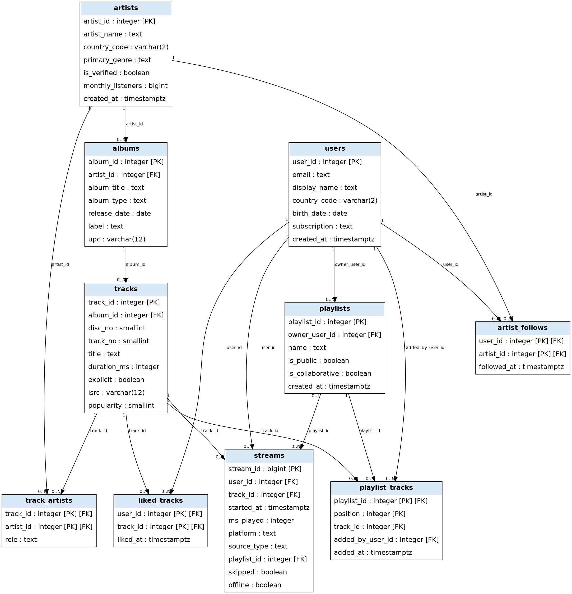

# Phase 2: Schema Design

**Team:** T0108 | **Sections:** A,B and E

## Scope and execution

The design uses all 10 CSV exports from the repository seed archive, preserving their table names, column names, column order, and rows. Only PRIMARY KEY and UNIQUE constraints create indexes; no tuning indexes, triggers, or generated columns are added. PostgreSQL 15+ is the target.

Run from the repository root after extracting `seed_data.zip`:

```bash
createdb spotify_phase2
psql -X -v ON_ERROR_STOP=1 -d spotify_phase2 -f sql/01_schema.sql
psql -X -v ON_ERROR_STOP=1 -d spotify_phase2 -f sql/02_load_data.sql
psql -X -v ON_ERROR_STOP=1 -d spotify_phase2 -f sql/03_integrity_checks.sql
```

Schema creation and loading each use a transaction. A failed load rolls back its inserts. These scripts intentionally do not drop or clear existing data. Run once in a fresh database. IDs are supplied by the export and workload, so they do not need sequences. The load script uses parent-before-child order and finishes with ANALYZE. Use a consistent Asia/Kolkata session timezone for later date-based comparisons; SET here affects only the current connection.

## Data dictionary

All columns are NOT NULL (including primary-key columns) except `streams.playlist_id`. All timestamp columns use `timestamptz` to preserve instants from offset-bearing CSV values. Text codes retain leading zeroes. PostgreSQL boolean input accepts the CSV values `t` and `f`.

### `artists`

| Column | Type | Constraints / default | Reason |
|---|---|---|---|
| `artist_id` | `integer` | `PRIMARY KEY CHECK (artist_id > 0)` | Stable positive entity identifier. |
| `artist_name` | `text` | `NOT NULL CHECK (btrim(artist_name) <> '')` | Descriptive value; not assumed globally unique. |
| `country_code` | `varchar(2)` | `NOT NULL CHECK (country_code ~ '^[A-Z]{2}$')` | Two-letter uppercase code; format validation, not a country registry. |
| `primary_genre` | `text` | `NOT NULL CHECK (btrim(primary_genre) <> '')` | Descriptive value; not assumed globally unique. |
| `is_verified` | `boolean` | `NOT NULL DEFAULT false` | Boolean business attribute. |
| `monthly_listeners` | `bigint` | `NOT NULL DEFAULT 0 CHECK (monthly_listeners >= 0)` | Stored audience snapshot; bigint accommodates aggregate counts. |
| `created_at` | `timestamptz` | `NOT NULL` | Event or creation instant with timezone support. |

Candidate key(s): **artist_id**.

### `albums`

| Column | Type | Constraints / default | Reason |
|---|---|---|---|
| `album_id` | `integer` | `PRIMARY KEY CHECK (album_id > 0)` | Stable positive entity identifier. |
| `artist_id` | `integer` | `NOT NULL REFERENCES artists ON DELETE RESTRICT` | Referenced entity identifier. |
| `album_title` | `text` | `NOT NULL CHECK (btrim(album_title) <> '')` | Descriptive value; not assumed globally unique. |
| `album_type` | `text` | `NOT NULL CHECK (album_type IN ('ALBUM','EP','SINGLE','COMPILATION'))` | Closed set observed in export and defined by the brief. |
| `release_date` | `date` | `NOT NULL` | Calendar release date. |
| `label` | `text` | `NOT NULL CHECK (btrim(label) <> '')` | Descriptive value; not assumed globally unique. |
| `upc` | `varchar(12)` | `NOT NULL UNIQUE CHECK (upc ~ '^[0-9]{12}$')` | 12-digit catalogue code retained as text; unique in this model. |

Candidate key(s): **album_id; upc**.

### `tracks`

| Column | Type | Constraints / default | Reason |
|---|---|---|---|
| `track_id` | `integer` | `PRIMARY KEY CHECK (track_id > 0)` | Stable positive entity identifier. |
| `album_id` | `integer` | `NOT NULL REFERENCES albums ON DELETE RESTRICT` | Referenced entity identifier. |
| `disc_no` | `smallint` | `NOT NULL CHECK (disc_no > 0)` | Positive disc position within album. |
| `track_no` | `smallint` | `NOT NULL CHECK (track_no > 0)` | Positive track position within disc. |
| `title` | `text` | `NOT NULL CHECK (btrim(title) <> '')` | Descriptive value; not assumed globally unique. |
| `duration_ms` | `integer` | `NOT NULL CHECK (duration_ms > 0)` | Positive whole-millisecond recording duration. |
| `explicit` | `boolean` | `NOT NULL DEFAULT false` | Boolean business attribute. |
| `isrc` | `varchar(12)` | `NOT NULL UNIQUE CHECK (isrc ~ '^[A-Z]{2}[A-Z0-9]{3}[0-9]{7}$')` | 12-character recording code; unique in this supplied catalogue. |
| `popularity` | `smallint` | `NOT NULL CHECK (popularity BETWEEN 0 AND 100)` | Small integer score from 0 to 100. |

Candidate key(s): **track_id; isrc; (album_id, disc_no, track_no)**.
Table constraints: `UNIQUE (album_id, disc_no, track_no)`.

### `track_artists`

| Column | Type | Constraints / default | Reason |
|---|---|---|---|
| `track_id` | `integer` | `NOT NULL REFERENCES tracks ON DELETE CASCADE` | Referenced entity identifier. |
| `artist_id` | `integer` | `NOT NULL REFERENCES artists ON DELETE RESTRICT` | Referenced entity identifier. |
| `role` | `text` | `NOT NULL CHECK (role IN ('PRIMARY','FEATURED'))` | One PRIMARY/FEATURED role for a track-artist pair. |

Candidate key(s): **(track_id, artist_id)**.
Table constraints: `PRIMARY KEY (track_id, artist_id)`.

### `users`

| Column | Type | Constraints / default | Reason |
|---|---|---|---|
| `user_id` | `integer` | `PRIMARY KEY CHECK (user_id > 0)` | Stable positive entity identifier. |
| `email` | `text` | `NOT NULL UNIQUE CHECK (email ~ '^[^[:space:]@]+@[^[:space:]@]+[.][^[:space:]@]+$')` | Unique login address; simple structural check, case-sensitive uniqueness. |
| `display_name` | `text` | `NOT NULL CHECK (btrim(display_name) <> '')` | Descriptive value; not assumed globally unique. |
| `country_code` | `varchar(2)` | `NOT NULL CHECK (country_code ~ '^[A-Z]{2}$')` | Two-letter uppercase code; format validation, not a country registry. |
| `birth_date` | `date` | `NOT NULL` | Calendar date; cannot follow account creation in the India timezone. |
| `subscription` | `text` | `NOT NULL CHECK (subscription IN ('FREE','PREMIUM','DUO','STUDENT','FAMILY'))` | Allowed subscription categories in the export. |
| `created_at` | `timestamptz` | `NOT NULL` | Event or creation instant with timezone support. |

Candidate key(s): **user_id; email**.
Table constraints: `CHECK (birth_date <= (created_at AT TIME ZONE 'Asia/Kolkata')::date)`.

### `playlists`

| Column | Type | Constraints / default | Reason |
|---|---|---|---|
| `playlist_id` | `integer` | `PRIMARY KEY CHECK (playlist_id > 0)` | Stable positive entity identifier. |
| `owner_user_id` | `integer` | `NOT NULL REFERENCES users ON DELETE RESTRICT` | Referenced entity identifier. |
| `name` | `text` | `NOT NULL CHECK (btrim(name) <> '')` | Descriptive value; not assumed globally unique. |
| `is_public` | `boolean` | `NOT NULL DEFAULT false` | Boolean business attribute. |
| `is_collaborative` | `boolean` | `NOT NULL DEFAULT false` | Boolean business attribute. |
| `created_at` | `timestamptz` | `NOT NULL` | Event or creation instant with timezone support. |

Candidate key(s): **playlist_id**.
Table constraints: `CHECK (NOT (is_public AND is_collaborative))`.

### `playlist_tracks`

| Column | Type | Constraints / default | Reason |
|---|---|---|---|
| `playlist_id` | `integer` | `NOT NULL REFERENCES playlists ON DELETE CASCADE` | Referenced entity identifier. |
| `position` | `integer` | `NOT NULL CHECK (position > 0)` | Positive playlist slot; permits repeated tracks at different positions. |
| `track_id` | `integer` | `NOT NULL REFERENCES tracks ON DELETE RESTRICT` | Referenced entity identifier. |
| `added_by_user_id` | `integer` | `NOT NULL REFERENCES users ON DELETE RESTRICT` | Referenced entity identifier. |
| `added_at` | `timestamptz` | `NOT NULL` | Event or creation instant with timezone support. |

Candidate key(s): **(playlist_id, position)**.
Table constraints: `PRIMARY KEY (playlist_id, position)`.

### `streams`

| Column | Type | Constraints / default | Reason |
|---|---|---|---|
| `stream_id` | `bigint` | `PRIMARY KEY CHECK (stream_id > 0)` | Stable positive entity identifier. |
| `user_id` | `integer` | `NOT NULL REFERENCES users ON DELETE RESTRICT` | Referenced entity identifier. |
| `track_id` | `integer` | `NOT NULL REFERENCES tracks ON DELETE RESTRICT` | Referenced entity identifier. |
| `started_at` | `timestamptz` | `NOT NULL` | Event or creation instant with timezone support. |
| `ms_played` | `integer` | `NOT NULL CHECK (ms_played >= 0)` | Nonnegative elapsed milliseconds. |
| `platform` | `text` | `NOT NULL CHECK (platform IN ('ANDROID','IOS','WEB','DESKTOP','SPEAKER','CAR'))` | Allowed playback platforms in the export. |
| `source_type` | `text` | `NOT NULL CHECK (source_type IN ('PLAYLIST','ALBUM','ARTIST','RADIO','SEARCH'))` | Playback origin; linked to playlist reference nullability. |
| `playlist_id` | `integer` | `REFERENCES playlists ON DELETE RESTRICT` | Referenced entity identifier. |
| `skipped` | `boolean` | `NOT NULL` | Stored export flag; constrained to the supplied under-30-second rule. |
| `offline` | `boolean` | `NOT NULL DEFAULT false` | Defaults false so supplied W01 can omit it. |

Candidate key(s): **stream_id**.
Table constraints: `CHECK ((source_type = 'PLAYLIST') = (playlist_id IS NOT NULL))`; `CHECK (skipped = (ms_played < 30000))`.

### `liked_tracks`

| Column | Type | Constraints / default | Reason |
|---|---|---|---|
| `user_id` | `integer` | `NOT NULL REFERENCES users ON DELETE CASCADE` | Referenced entity identifier. |
| `track_id` | `integer` | `NOT NULL REFERENCES tracks ON DELETE CASCADE` | Referenced entity identifier. |
| `liked_at` | `timestamptz` | `NOT NULL` | Event or creation instant with timezone support. |

Candidate key(s): **(user_id, track_id)**.
Table constraints: `PRIMARY KEY (user_id, track_id)`.

### `artist_follows`

| Column | Type | Constraints / default | Reason |
|---|---|---|---|
| `user_id` | `integer` | `NOT NULL REFERENCES users ON DELETE CASCADE` | Referenced entity identifier. |
| `artist_id` | `integer` | `NOT NULL REFERENCES artists ON DELETE CASCADE` | Referenced entity identifier. |
| `followed_at` | `timestamptz` | `NOT NULL` | Event or creation instant with timezone support. |

Candidate key(s): **(user_id, artist_id)**.
Table constraints: `PRIMARY KEY (user_id, artist_id)`.

## Relationships and deletion policy

Each child reference points to exactly one parent, except a stream can reference zero or one playlist. A parent may have zero or many child rows. Junction tables represent track–artist, playlist–track, user–track likes, and user–artist follows relationships.

| Parent → child | Foreign key | ON DELETE |
|---|---|---|
| `artists` → `albums` | `albums.artist_id` | RESTRICT |
| `albums` → `tracks` | `tracks.album_id` | RESTRICT |
| `tracks` → `track_artists` | `track_artists.track_id` | CASCADE |
| `artists` → `track_artists` | `track_artists.artist_id` | RESTRICT |
| `users` → `playlists` | `playlists.owner_user_id` | RESTRICT |
| `playlists` → `playlist_tracks` | `playlist_tracks.playlist_id` | CASCADE |
| `tracks` → `playlist_tracks` | `playlist_tracks.track_id` | RESTRICT |
| `users` → `playlist_tracks` | `playlist_tracks.added_by_user_id` | RESTRICT |
| `users` → `streams` | `streams.user_id` | RESTRICT |
| `tracks` → `streams` | `streams.track_id` | RESTRICT |
| `playlists` → `streams` | `streams.playlist_id` | RESTRICT |
| `users` → `liked_tracks` | `liked_tracks.user_id` | CASCADE |
| `tracks` → `liked_tracks` | `liked_tracks.track_id` | CASCADE |
| `users` → `artist_follows` | `artist_follows.user_id` | CASCADE |
| `artists` → `artist_follows` | `artist_follows.artist_id` | CASCADE |

RESTRICT preserves catalogue provenance, listening history, and contributor attribution until dependencies are handled explicitly. CASCADE removes dependent relationship rows (credits, playlist entries, likes, follows) when their parent can actually be deleted. Other RESTRICT relationships may still prevent that deletion. SET NULL is intentionally not used for playlist streams: removing their playlist ID would contradict the source/playlist consistency rule. This is an assignment retention policy, not a complete production account-erasure design.



Editable Mermaid source: [`er_diagram.mmd`](../diagrams/er_diagram.mmd). Every edge in the PNG is labeled with its FK and cardinalities.

## Functional dependencies and normal forms

Let “all attributes” mean the columns listed in that table’s dictionary. Dependencies below are business assumptions, not conclusions drawn merely from accidentally unique sample values. Atomic columns satisfy 1NF. Composite-key relationship attributes depend on their whole key, satisfying 2NF.

| Table | Functional dependencies | Assessment |
|---|---|---|
| `artists` | artist_id → all attributes (each listed candidate key separately) | BCNF under the stated dependencies. |
| `albums` | album_id; upc → all attributes (each listed candidate key separately) | BCNF under the stated dependencies. |
| `tracks` | track_id; isrc; (album_id, disc_no, track_no) → all attributes (each listed candidate key separately) | BCNF under the stated dependencies. |
| `track_artists` | (track_id, artist_id) → all attributes (each listed candidate key separately) | BCNF under the stated dependencies. |
| `users` | user_id; email → all attributes (each listed candidate key separately) | BCNF under the stated dependencies. |
| `playlists` | playlist_id → all attributes (each listed candidate key separately) | BCNF under the stated dependencies. |
| `playlist_tracks` | (playlist_id, position) → all attributes (each listed candidate key separately) | BCNF under the stated dependencies. |
| `streams` | stream_id → all attributes; ms_played → skipped under the enforced threshold rule | 2NF, with an intentional 3NF/BCNF exception: non-key ms_played determines non-key skipped. |
| `liked_tracks` | (user_id, track_id) → all attributes (each listed candidate key separately) | BCNF under the stated dependencies. |
| `artist_follows` | (user_id, artist_id) → all attributes (each listed candidate key separately) | BCNF under the stated dependencies. |

**Retained redundancy:** `artists.monthly_listeners` is a stored aggregate snapshot refreshed by W04; it can become stale and must not be treated as an independent source of truth. It is not an additional non-key dependency within the artists table. `streams.skipped` is retained to load the export unchanged and support the given queries; its CHECK prevents inconsistency but does not remove the normalization exception. Removing it and deriving it in a view would be a future redesign. Album artist and the PRIMARY credit agree in the seed data; that is cross-table redundancy retained for workload compatibility, not an additional intra-table dependency. Compilations may require a different business rule in a broader catalogue.

**Rules requiring cross-row checks:** exactly one PRIMARY artist per track, agreement with album artist, stream duration no greater than track duration, and no pre-release streams are audited below. Ordinary row CHECK constraints cannot enforce these cross-table rules. No partial unique indexes or triggers are added in this phase. A single ISRC per track row is an explicit assignment-model assumption; a production catalogue may list the same recording on multiple releases.

## Seed inspection and validation

CSV inspection found empty fields only in `streams.playlist_id`: **137,386** rows. The remaining **112,614** streams have a playlist ID. Each missing playlist ID belongs to a non-PLAYLIST source, and every PLAYLIST source has an ID. All other exported columns have zero empty values.

| Table | Expected, CSV and PostgreSQL rows |
|---|---:|
| `artists` | 3,000 |
| `albums` | 12,000 |
| `tracks` | 67,808 |
| `track_artists` | 77,489 |
| `users` | 30,000 |
| `playlists` | 10,000 |
| `playlist_tracks` | 120,004 |
| `streams` | 250,000 |
| `liked_tracks` | 58,533 |
| `artist_follows` | 69,901 |

The export contains **1,800** `(playlist_id, track_id)` groups with repeated tracks. These are valid playlist entries at distinct positions, not duplicate primary keys; imposing uniqueness on that pair would incorrectly reject data. Candidate keys were checked for duplicates. No stream exceeded its track duration or preceded its album release; every track had exactly one PRIMARY credit and it matched the album artist.

Validation used **PostgreSQL 17.12** in single-user mode on this workspace. All schema statements executed successfully, all 10 CSVs loaded with all constraints enabled, and database row counts matched the table above. Network/socket restrictions prevented a normal server connection, so the psql `\copy` lines were translated to equivalent server-side `COPY` statements with absolute paths for this check. The supplied psql wrapper itself must still be run on your machine; no benchmark timings are claimed.

All 25 supplied read queries successfully planned with EXPLAIN. All five write queries executed successfully in separate rolled-back transactions, including W01 with its omitted offline column. This is schema compatibility validation, not Phase 3 benchmarking or proof of original-query business correctness.

| Integrity check | PostgreSQL violations |
|---|---:|
| Streams before album release (Asia/Kolkata date) | 0 |
| Streams exceeding track duration | 0 |
| Tracks without exactly one PRIMARY credit | 0 |
| PRIMARY credit different from album artist | 0 |
| Source type inconsistent with playlist reference | 0 |
| Skip flag inconsistent with the 30-second rule | 0 |
| Playlists both public and collaborative | 0 |

The database also confirmed 1,800 repeated-track groups, 137,386 NULL playlist IDs, 112,614 non-NULL playlist IDs, and exactly 14 constraint-backed indexes. Reproduce the checks with `sql/03_integrity_checks.sql`; raw validation output is in [`phase2_validation.txt`](phase2_validation.txt).

## Baseline index inventory

Verified: **14 constraint-backed B-tree indexes**: one primary-key index per table (10), plus UNIQUE indexes on albums.upc, tracks.isrc, tracks(album_id, disc_no, track_no), and users.email (4). Foreign keys do not automatically create child-side indexes. Existing leading PK columns already support some lookups; do not add redundant tuning indexes before Phase 3. The integrity script lists actual indexes for confirmation.

## Limitations and data decisions

No exported rows are modified or discarded. The 30-second skip equivalence and private-only collaborative playlists are rules of this supplied dataset, not universal Spotify behavior. The birth-date check uses account creation rather than CURRENT_DATE, avoiding a time-dependent constraint. The email check is intentionally basic. No upper timestamp bound or frozen dataset date is imposed, allowing the supplied July write queries. Validation findings are observations of this seed dataset, not guarantees about future imports.


Seed archive SHA-256: `cb4128a26bde95196ef9aa78057cf99fc0cf408329a8d727dbd5051c6c5f0bab`.
